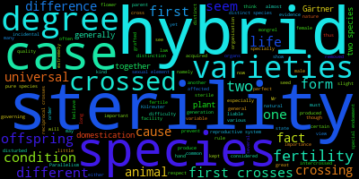

# Assignment 1

## Number of Subjects
### A
To download the file, we can do a simple git pull then a further copy command can move the file to the students desired destination such as the code that follows
```bash
git pull
cp Gesquiere2011_data.csv ../../IBC_2026_ChaseZellman/Assignments/
```

### B & C
For this code we have our bash shebang to start the code then File_name and ID are my variables like asked. They take in argument 1 and 2 as their values respectively. Then the code is a simple cut and grep. It takes the first column and finds how many times the number you give it appears. Then it out puts the number you asked for and how many times it appears.

For clarity ID_Num has 
```Bash
$()
```
with the code in the parenthesis that allows you to assign a commands output to a variable. Also, variables are called with 
```Bash
"${}" 
```
I prefer this over lots of " "$" " which can make things confusing for me when lots of parenthesis are used

```Bash
#!/usr/bin/bash

#Variable assigning takes in the first and second arguement
File_name="$1"
ID="$2"

#ID_num takes first column of file name inputted and then finds how many times the ID input is in there
ID_num=$(cut -f 1 "${File_name}" | grep -x -c "${ID}")
echo "${ID} appears ${ID_num} Times!"
```

### D
Starting here we assign ID_Count to a command which here we use the tail to get rid of the header extremely similar to one of our activities in class a few weeks ago. Then it cuts the first column, sorts by number and uniqueness to get each unique one. 
After that an empty file is created in CSV format and we put in our headers.
Then the main chunk of the code while reading ID_Count, take the first column, count each unique line that matches ID count, then it adds the number and the number of times it was sampled into our file. Finaly, it loops back through the list to the next number.
```Bash
#!/usr/bin/bash

ID_Count=$(tail -n +2 Gesquiere2011_data.csv | cut -f 1 | sort -n -u | wc -l)

echo "MaleID,Num_samples" > Num_samples.csv

while read -r ID_Count
    do ID_Times_Count=$( cut -f 1 Gesquiere2011_data.csv | grep -x -c "${ID_Count}")
        echo "${ID_Count},${ID_Times_Count}" >> Num_samples.csv
done < <(tail -n +2 Gesquiere2011_data.csv | cut -f 1 | sort -n -u)

echo "Script Finished!"
```

## Mining The Origin of Species
### A
Here we use a curl command that you can run in the terminal, a link to this was given in the directions. I named my file The_Orgin_Darwin.txt
```Bash
curl https://www.gutenberg.org/cache/epub/1228/pg1228.txt -o The_Orgin_Darwin.txt
```

### B
For finding how many times they were mentioned in the book we use grep to search for a word and as directions asked we add the -i to make it case insensitive, finally we piped on a wc -l to tell us how many times it was mentioned
```Bash
grep -i "sterility" The_Orgin_Darwin.txt | wc -l
grep -i "isolation" The_Orgin_Darwin.txt | wc -l
```

### C
For this question we need to stay searching case insensitive but we also were to search for the 3 lines before and after our word so the -B (Before) and -A (After) is added. Then we need to add the result to a text file. So, you can see I have a file for each named after the key word.
```Bash
grep -i -B 3 -A 3 "sterility" The_Orgin_Darwin.txt > sterility.txt
grep -i -B 3 -A 3 "isolation" The_Orgin_Darwin.txt > isolation.txt
```

### D
Building the wordcloud was next and I had issues using the Conda so I opted for the pip option for downloading wordcloud and using the python version which is still run out of the terminal just similarly when we run a script in a language you just have to specify that is why it starts with python.
```Bash
python -m wordcloud --text sterility.txt --imagefile sterility_cloud.png
python -m wordcloud --text isolation.txt --imagefile isolation_cloud.png
```

### E



It is hard to tell based on the word cloud but in both clouds, however I would argue that the Isolation word cloud provides more evidence for Darwin then the Sterility. We see isolation as the largest concentration of words but then also a few others like favorable, which can be linked to favorable mates, traits, etc. Is important for speciation. Along with Natural selection being another important concept. Then in smaller text we see immigration, production, competition all of which affect gene flow and fitness and that can increase or decrease speciation events and evolution. In sterility it is harder to deduct concepts, sterility is the largest word, followed by others like hybrid, species, varieties, difference, and more. All of which point to more of the same thing. 

## Twelve Days of Christmas
For this one we had to print the 12 days of Christmas and their gifts in python for this I started with two lists Day_list for the days, then Verse_list for the gifts

```python
Day_list = [
    "First",
    "Second",
    "Third",
    "Fourth",
    "Fith",
    "Sixth",
    "Seventh",
    "Eighth",
    "Ninth",
    "Tenth",
    "Eleventh",
    "Twelth",
]

Verse_list = [
    "A Partridge in a Pear Tree",
    "2 Turtle Doves",
    "3 French Hens",
    "4 Colly Birds",
    "5 Gold Rings",
    "6 Geese-a-Laying", 
    "7 Swans-a-Swimming",
    "8 Maids-a-Milking",
    "9 Ladies Dancing",
    "10 Lords-a-Leaping",
    "11 Pipers Piping",
    "12 Drummers Drumming"
]
```

Then using my two lists for the i or a numeric value in the length of Day_list (12 days), print our starting statement and using whatever days number we are on print that day from the list. 
One important note here is the use of the f string on the print statement. This allows you to have your print statement and call variables inside of it to avoid lots of "" and + in your prints
Then we create a nested for loop like shown in the directions to go through the verses. The three values starting with i matches the i in the first loop to match the day, then -1 is the stop so it will go down to 0, and then the -1 is what it counts by to go backwards to fill in the previous verses. The if j ==1 prints the Turtle doves line which has the , and that was in the other file.
Finally, we print the rest of the verses and at the end "\n" to make a new line
```python
for i in range(len(Day_list)):
    print(f"On the {Day_list[i]} day of Christmas my true love gave to me:")
    for j in range(i, -1, -1):
        if j == 1:
            print(Verse_list[j] + ", and")
        else:
            print(Verse_list[j])
    print("\n")
```
