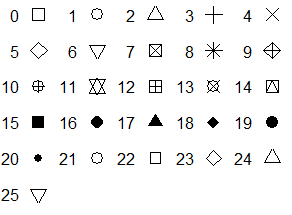
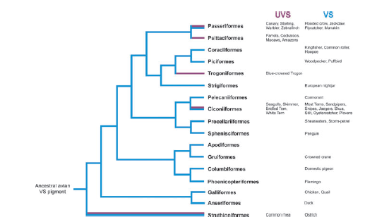
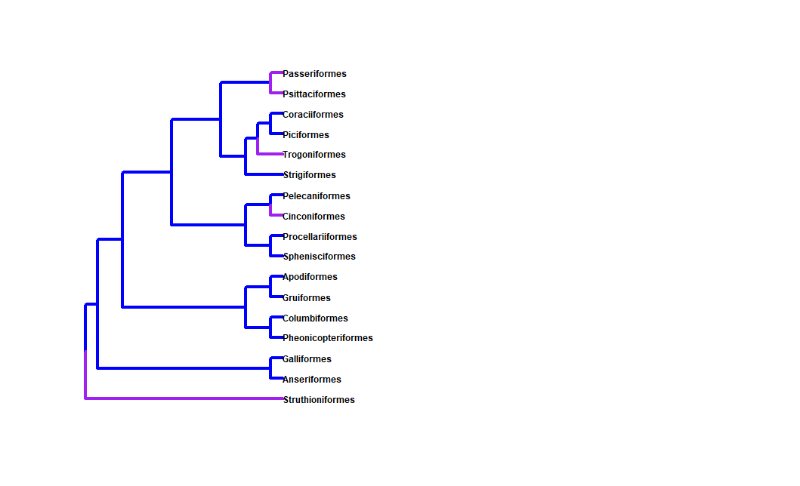

### Week 11 Problems
## 5.1 pch Symbols

Using similar code to what we did in class I created my grid using `par(mfrow=c(6,5))` and then the only additional thing I needed to add eventually because I ran into margin errors was the `mar` code and this I had to adjust until it was right. Then I created a variable for the pch named `pch` and it was the values from 0 to 25. Then for my for loop, I used similar code to what was on the website for the example figure. The `pch_symbol` is whatever the number it is at in the loop. `bty = "n"` had to be added in because when I would put the symbols in it would make boxes around them so that was something new I learned. `las = 1` Makes the numbers upright. The `mtext` line of code adds in the number of whatever the loop value is at next to the symbol and the side and line had to be played around with as well in order to make it look correct. 
``` R
par(mfrow=c(6,5), mar = c(1, 2, .5, .5))
pch <- 0:25

for(pch_symbol in pch){
  plot(1, 1, pch = pch_symbol, cex = 2.5, xaxt = "n", yaxt = "n",
       ann = FALSE, bty = "n")
  mtext(pch_symbol, side = 2, line = 0.5, las = 1)
}
```


## 5.2 Recreate a Figure
### Molecular ecology and adaption of visual photopigments in craniates
`Davies, W. I. L., Collin, S. P., & Hunt, D. M. (2012). Molecular ecology and adaptation of visual photopigments in craniates. Molecular Ecology, 21(13), 3121–3158. https://doi.org/10.1111/j.1365-294x.2012.05617.x`



For my code I used the package `ape` which I have used in the past for my other phylogenies however this time I made my own tree and that was a fun exercise for me to do and will be useful in the future. Then I made all my edge colors blue to match the blue lines they had. Then to add in the purple I made a vector with the ones that needed to be purple then made a for loop in order to turn them purple. Then plotted it similar to how it looked in the picture.
```R
library(ape)

Copy_Tree <- read.tree(text = "(Struthioniformes,
                       ((Anseriformes,Galliformes),
                       (((Pheonicopteriformes, Columbiformes),
                       (Gruiformes, Apodiformes)),
                       (((Sphenisciformes, Procellariiformes),
                       (Cinconiformes, Pelecaniformes)),
                       ((Strigiformes,
                       (Trogoniformes,
                       (Piciformes, Coraciiformes))),
                       (Psittaciformes, Passeriformes))))));")

edge_colors <- rep("blue", nrow(Copy_Tree$edge))

purples <- c("Struthioniformes", "Cinconiformes", "Trogoniformes",
            "Psittaciformes", "Passeriformes")

for(name in purples){
  edge_colors[which.edge(Copy_Tree, name)] <- "purple"
}

plot(Copy_Tree, cex = .75, edge.color = edge_colors, edge.width = 4,
     font = 2)
```
My phylogeny could definitely be better with more time and research, and I did not include the side part as well that has the color descriptions and the types of species with them as well. I think that they had a good figure in the paper. It was easy to visualize and understand the data and point they were trying to show which is always important in research. Also, I am sure with some work it could be recreated especially with having a tree file that does not have to be made. 

